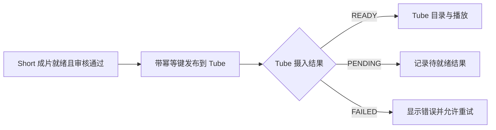

# Short 产品定位与交付核查（2026-10-06）

源码基线：`d59ed4e1371be02595a32fdde83c35ecbad7ad78`（远端 develop）。本记录校准既有定位、参考范围和实现说明，不新增接口、状态、页面或数据库契约。历史验收记录保留原日期；以下源码核查不能替代真实生成与播放验收。

## 产品分工

`bgssai-short` 是 AI 短剧制作平台，面向创作者完成故事/剧本、分集、角色与场景、分镜、素材生成、配音字幕、合成及导出。成片可以直接发布到 `bgssai-tube`。Short 负责制作与发布交接，Tube 负责目录、分发与播放；`bgssai-long` 负责长篇改编及长剧制作。

既有需求入口：[制作功能目录](../feature/README.md)、[成片合成与导出](../feature/film-compose-export.md)、[成片发布到 Tube](../feature/film-publish-media.md)。

## 六个参考项目的具体用途

以下是已读取的工作区参考快照，不表示上游最新版本或 BGSSAI 已具备全部对应能力。链接固定到参考提交；能力说明来自项目自身文档，采用方向是本次核查的判断。

| 参考快照 | 核查到的能力 | Short 对照重点 |
| --- | --- | --- |
| [waoowaoo / dfec20e](https://github.com/waooAI/waoowaoo/blob/dfec20e32298ed675050329e4a41477024148399/README.md) | Assistant、参考素材上传、画布、生成结果版本、按模型提供首帧/首尾帧等模式；本快照未提供音乐与配音控件 | 创作辅助、参考素材及结果版本管理；按模型能力显示可选参数 |
| [Jellyfish / a967819](https://github.com/Forget-C/Jellyfish/blob/a9678194ddf2d9be3ccbe78d4287d87d5089e123/README.md) | 结构化分镜、候选确认、角色/场景/道具/服装一致性、异步任务取消与恢复 | 分镜准备到生成的确认流程、资产复用与可追踪任务 |
| [ArcReel / 9d48599d](https://github.com/ArcReel/ArcReel/blob/9d48599df2ee3a782983db02d4a5f0ef1588d460/README.md) | 故事/剧本到资产与视频、人工确认、费用追踪、剪映草稿导出 | 阶段确认、素材返工、实际用量与可继续编辑的交付 |
| [LocalMiniDrama / 755192a](https://github.com/xuanyustudio/LocalMiniDrama/blob/755192a70517fa392e034c58f2e92da41e7fc56a/README.md) | 剧本到分镜与合成、可视化画布、节点编辑/生成、整组重跑 | 镜头与画布交互、批量生成、失败后定点重跑 |
| [openframe / 9f978a5](https://github.com/murongg/openframe/blob/9f978a5d906388593f54ccdfa06b400d14430d49/README.md) | 剧本提取角色/道具/场景/分镜、视频合并、FCPXML/EDL 导出 | 结构化资产与剪辑工程导出 |
| [ZJT / 5cc1f0cb](https://github.com/jeffstric/ZJT/blob/5cc1f0cbc143b00aded02225e306d76351101ab0/README.md) | 专家 Agent 分工、分镜画布、模型选择与视频合成 | 专业创作步骤与人工干预点；Agent 编排的产品参考 |

参考交互与能力拆解后在现有产品工程中实现，不以整仓复制替代产品设计。六个项目均用于 Short 和 Long 的制作参考，不是 Tube 的播放内核。

## 当前源码证据

| 链路 | 证据 | 本次可得结论 |
| --- | --- | --- |
| 制作与合成 | [FfmpegComposeProvider](../../bgssai-short-user/bgssai-short-user/src/main/java/com/bgssai/shortai/aiprovider/FfmpegComposeProvider.java) 及制作功能目录 | 已有实现路径；未在本次调用付费模型或产出真实短剧 |
| 发布闸门与结果记录 | [FilmPublishToMediaService](../../bgssai-short-user/bgssai-short-user/src/main/java/com/bgssai/shortai/production/service/FilmPublishToMediaService.java) | 已实现 READY、审核、素材等发布条件、单集/批量发布与结果记录 |
| 跨仓 HTTP 交接 | [RestMediaIngestClient](../../bgssai-short-user/bgssai-short-user/src/main/java/com/bgssai/shortai/production/media/RestMediaIngestClient.java) | 已调用 Tube 摄入，携带鉴权及幂等键；有失败重试与响应校验 |
| 本仓验证入口 | [发布服务测试](../../bgssai-short-user/bgssai-short-user/src/test/java/com/bgssai/shortai/production/service/FilmPublishToMediaServiceTest.java)、[客户端测试](../../bgssai-short-user/bgssai-short-user/src/test/java/com/bgssai/shortai/production/media/RestMediaIngestClientTest.java) | 单测能验证本仓规则，不能证明成片在 Tube 或移动端实际播放 |

## 发布与播放的验收顺序

沿现有 [Short → Tube 契约](../api/short-to-media-publish.md) 验收：

1. 真实生成/合成：从同一作品取得有声画、字幕及可访问文件的成片，记录模型、输入、输出与耗时。
2. 实际跨仓发布：从 Short 工作室发布，核对 Tube 目录、分集与源作品对应；READY 后打开 Tube 播放页验证声画和拖动。
3. 幂等与失败：同一成片重复发布保持目录稳定；网络失败、PENDING、素材过期与审核未通过分别验收，不能都按发布成功处理。
4. 多端播放：同一 Tube 条目依次在 Windows、Web、Android、iOS 播放；记录端版本、设备及播放样本。Tube 客户端壳存在不代表本项通过。

优先打通真实成片到 Tube Web 的一集闭环，再验证批量、重试与多端；六个参考项目的增强项按既有制作需求逐项验收。任何实际功能变更均须先落需求、HTML 原型、详设，再同步代码与 SQL。

## 本次交付边界

本次验证：完整 `mvn -B -ntp test` 编译/测试成功，共 273 项，失败/错误为 0、跳过 5 项（FFmpeg、成片验收及数据库上下文等环境条件）。修改文档的本地链接存在性检查与 `git diff --check` 通过。跳过的测试和未执行的真实链路不记为通过。

本次仅订正文档并整理核查证据。原型、API、应用代码和 SQL 不涉及修改，理由是既有对外契约与业务行为均未改变。dev/prod 均部署 develop，分别使用 `application-dev.properties` / `application-prod.properties`。本次未部署、未执行线上数据库脚本、未完成真实成片跨仓或真机播放验收。
